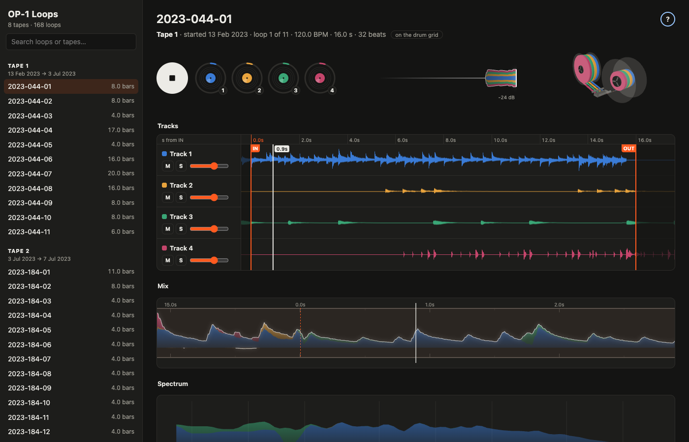

# OP-1 Loops

**▶ Listen: [akivab.github.io/op1-loops](https://akivab.github.io/op1-loops/)**

Four-track loops cut from my OP-1 field tapes, played sample-accurately in the browser with the
Web Audio API. Switch tracks on and off (now or on the next loop) and watch the mix and
spectrum. Press `?` on the page for the controls.

## How it works

- **Your Mac** turns tape backups into loops. Scripts read each tape's clip list, cut four WAV
  stems per loop into `public/audio/` (~1.9 GB, not in git), and encode web copies as Opus
  into `public/opus/` (~185 MB, in git). The loop list lives in `data/loops.json`.
- **GitHub Pages** serves a static build of whatever is committed. Every push to `main` runs
  the workflow in `.github/workflows/pages.yml`, which builds the site and publishes it.

The page is a player only: there is no editing on it. Loop points and names are set in
`data/loops.json`.

## Set it up for your own OP-1 field

It reads OP-1 field tapes: each tape folder holds `track_1.wav` … `track_4.wav` and a
`tape.json` that lists every clip (where each recording starts and stops). That clip list is
how loops are found, so you need tapes from an OP-1 field.

1. **Back up your tapes.** Copy the OP-1 field's `tapes` folder to your computer. Archived tapes
   are named for the day they were started (`2023-044#01` is day 44 of 2023), and `tape 01` is
   the one still on the device. Keep the files' modification times when you copy (e.g.
   `cp -Rp`), since the sidebar's "last saved" dates come from each `tape.json`'s mtime.
2. **Get the code and clear out my loops.** Fork this repo (or copy it into a new one), clone
   it, then remove my data and audio:

       git rm -r -q data/loops.json data/tapes.json public/opus

3. **Install.** You need Node 20+ and Python 3:

       npm install
       python3 -m venv .venv && .venv/bin/pip install numpy==1.26.4 scipy==1.13.1 soundfile==0.13.1

4. **Find and cut your loops**, pointing `OP1_TAPES_DIR` at your `tapes` folder:

       export OP1_TAPES_DIR="/path/to/your/tapes"
       npm run detect                                # data/loops.json: clips recorded on 2+ tracks at once
       npm run extract                               # public/audio/: 4 WAV stems per loop
       npm run tapes                                 # data/tapes.json: tape dates for the sidebar
       .venv/bin/python scripts/drumfit.py --apply   # optional: snap loops to their drum beat

5. **Listen.** `npm run dev` and open http://localhost:3000. To name a loop or change its
   points, edit it in `data/loops.json` (see [The loop list](#the-loop-list)).
6. **Make it yours.** The one-line story in the `?` box is in `components/LoopApp.tsx` (search
   for "Musical ideas"), and the page description is in `app/layout.tsx`.
7. **Publish.** Encode the stems for the web, commit and push:

       npm run encode
       git add -A && git commit -m "My OP-1 loops" && git push

   Then on GitHub, go to **Settings → Pages** and set **Source** to **GitHub Actions**. The site
   appears at `https://<your-username>.github.io/<repo-name>/` about a minute later; the repo
   name is picked up automatically. A public repo means your recordings are public.

## The scripts

Source tapes default to `~/Music/OP-1 backups/2026-11-20/tapes`; override with `OP1_TAPES_DIR`.
All times are tape-absolute samples at 44.1 kHz, matching the OP-1's `tape.json`.

| Command | What it does |
| --- | --- |
| `npm run detect` | Reads every `tape.json` and adds new loops to `data/loops.json`. Clips starting together on 2+ tracks make one loop. Existing loops are left alone. |
| `npm run extract` | Cuts 4 WAV stems per loop into `public/audio/<id>/`, padded by a bar (at least 2 s) each side. Skips loops whose stems already cover their points; `--all` re-cuts everything. |
| `npm run tapes` | Writes `data/tapes.json`: when each tape was started (from its name) and last saved. |
| `.venv/bin/python scripts/drumfit.py --apply` | Finds each loop's drum track and, where a steady grid fits, moves untouched loops so IN is on a hit and OUT a whole number of beats later. Sets `timing` to `bars`, `drums` or `free`. |
| `npm run encode` | Encodes the WAV stems to Opus in `public/opus/`, skipping ones already up to date. |
| `npm run dev` | The player at http://localhost:3000, playing the WAV stems. |
| `npm run card` | With the dev server running, captures the 3D reels mid-playback into `public/og.png`, the 1200×630 link-preview card, with the title and description baked in (X doesn't show a card's text). Bump `?v=` in `app/layout.tsx` after changing it. |

## The loop list

Each loop in `data/loops.json` has an `id`, its `tape`, a `name` (empty shows the id), `bpm`,
and `start` / `end`: tape sample positions at 44.1 kHz. `detected` keeps the original clip points
(and `clipDetected` them on loops drumfit moved), and `stem` records what was cut. To change a loop, edit `name`, `start`
or `end`, run `npm run extract` (it re-cuts only loops that moved past their padding), then
`npm run encode`.

## Publishing details

On each push to `main`, the workflow:

1. runs `npm ci`, then `npm run build:pages` with `BASE_PATH=/<repo-name>` (the site's path on
   github.io);
2. `build:pages` sets `STATIC=1`, so `next.config.ts` makes a static export into `out/` that
   plays the Opus stems instead of the WAVs;
3. uploads `out/` and deploys it.

Watch a deploy with `gh run watch`. To rebuild without pushing, run the workflow from the
repo's Actions tab.

**Why Opus:** the WAVs are too big for git. Opus only runs at 48 kHz, so `encode` resamples
first and the browser resamples back when it decodes. All four tracks of a loop come out the
same length, so they stay sample-locked.

**Preview the Pages build locally:**

    BASE_PATH=/op1-loops npm run build:pages
    mkdir -p /tmp/site && ln -sfn "$PWD/out" /tmp/site/op1-loops
    python3 -m http.server 8089 -d /tmp/site     # http://127.0.0.1:8089/op1-loops/

**Changing the workflow file** needs a GitHub login with the `workflow` scope
(`gh auth refresh -s workflow`, then `gh auth setup-git` so `git push` uses it).
